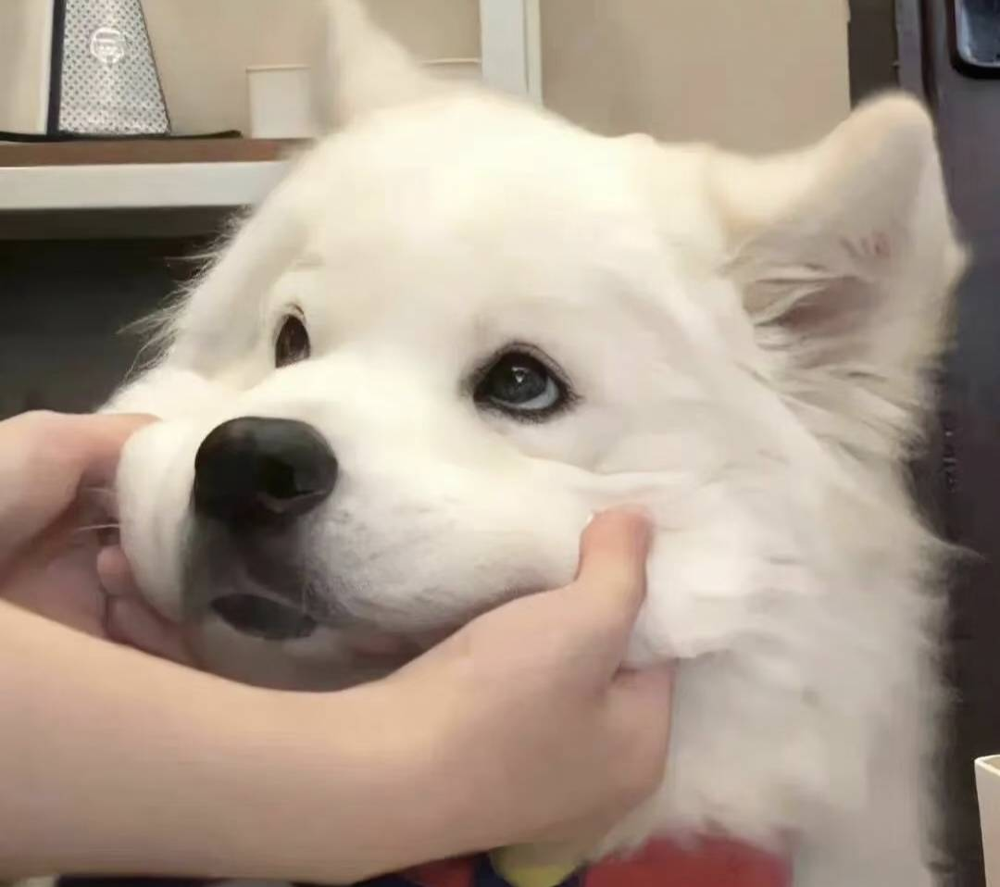

# 🐾 汪！有小狗混进队伍了！

**萨摩耶耶 · 巨蟹座 ♋ · 水象小狗 🌊**

快乐是出厂设置，科研是后天加载的插件。

**🤖 RoboParty ｜ 人形机器人整机测试 ｜ 🧠 Agent 研究**

**🧳 旅游 ｜ 🍅 红果 ｜ 🎤 随时高歌 ｜ 🎢 新奇体验 ｜ 🎀 仪式感**

---

### 🐶 关于本狗

你好！这里住着一只对世界保持好奇的快乐小狗。

目前研究生在读，在 **RoboParty** 折腾**人形机器人整机测试**，也在探索 **Agent**。每天都在思考如何让机器人更靠谱、让 Agent 更聪明，以及这段代码昨天到底为什么能跑。

- 🐾 **物种**：快乐小狗
- ♋ **属性**：巨蟹座 / 水象，脑内偶尔涨潮
- 🧠 **脑回路**：发现问题 → 研究问题 → “等一下，这个也好有意思！”
- 📡 **交流模式**：学术与非学术频道均已开启
- 🔋 **充电方式**：一个新点子，以及一句“我懂你意思了！”

### 🤖 最近在折腾什么

| 出没区域 | 小狗正在干什么 |
| :--- | :--- |
| 🤖 人形机器人整机测试 | 围着机器人转，试图搞清楚它这次又在想什么 |
| 🧠 Agent | 研究怎么让它少说两句“我将为你”，多干一点实事 |
| 🐕 快乐小狗事业 | 在科研间隙保持尾巴的基本摆动频率 |

### 🎒 离开工位，小狗还有大事要忙

- 🧳 **旅游**：定期把自己从工位打包带走，去别的城市。地图要展开，世界要亲自闻一闻！
- 🍅 **红果**：再看一集，就一集。……谁把下一集点开的？哦，是我的爪。
- 🎤 **随时高歌**：随机时间，随机地点，随机掉落个人演唱会。前奏可以没有，感情必须到位。
- 🎢 **新奇体验**：没试过？让我试试！好奇心负责报名，小狗本人负责到场。
- 🎀 **仪式感**：节日认真过，快乐认真存。普通的一天，也可以郑重其事地庆祝一下。

> 读一些有意思的书，做一些有意思的研究，  
> 去一些没去过的地方，然后一路唱着不一定在调上的歌。🐶🎶

### 💬 欢迎来找我玩！

可以聊 **机器人、Agent、论文、实验和奇奇怪怪的研究想法**，也可以交换旅行见闻、分享好看的剧情、讨论下一次想尝试的新鲜事。

今天遇见的小事、突然冒出来的脑洞，以及任何“这个好像没什么用，但真的很好玩”的东西，也欢迎投递！

**学术上一起刨坑，非学术上一起撒欢。**

不必等到有一个完整的问题才来交流——  
“我突然想到……”已经是一个很好的开场白了。🐾

**希望机器人站得稳，Agent 干得好**

**也希望下一趟旅行有好天气，今天有值得庆祝的小事情。**

